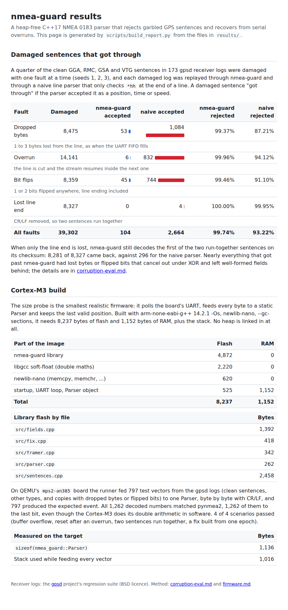

# nmea-guard

nmea-guard is a small C++17 library that parses GPS NMEA 0183 sentences one byte at a time, without using the heap. I wrote it because a lot of simple parsers only check the checksum when `*hh` sits exactly at the end of the line. If a serial read loop falls behind and drops bytes, damaged sentences get through as wrong positions, and I wanted to find out how often that happens on real receiver logs.

It also includes `nmea-replay`, a command-line tool that runs recorded logs through the parser and prints JSON. There's a seeded fault injector and two libFuzzer targets too. The same sources build for a Cortex-M3 with arm-none-eabi-gcc, and a bare-metal runner checks them on QEMU. MIT licensed.

## Running it

You need CMake 3.16 or newer and a C++17 compiler. CMake uses the system GoogleTest if you have it and downloads it if you don't. The Python tests need pynmea2 and pytest, fuzzing needs Clang, and the firmware build needs the Arm GNU toolchain and QEMU.

```sh
sudo apt-get install cmake g++ libgtest-dev python3-pip clang libclang-rt-dev \
    gcc-arm-none-eabi libnewlib-arm-none-eabi libstdc++-arm-none-eabi-newlib qemu-system-arm
python3 -m pip install -r requirements.txt

bash scripts/fetch_logs.sh          # gpsd's receiver logs -> data/gpsd/
cmake -S . -B build
cmake --build build
ctest --test-dir build --output-on-failure
python3 -m pytest -q
bash scripts/fuzz.sh 60             # 30 s per fuzz target, ASan + UBSan
make -C firmware qemu-test          # Cortex-M3 test vectors on QEMU, then flash/RAM sizes
```

GitHub Actions runs the same three groups as separate jobs (`.github/workflows/ci.yml`).

The logs come from the [gpsd](https://gitlab.com/gpsd/gpsd) regression suite (BSD licence). They aren't committed here, the fetch script downloads them. In firmware you feed the parser bytes from the UART and read the last complete fix:

```cpp
static nmea_guard::Parser gps;   // fixed size, no heap

void uart_rx_isr(uint8_t byte) {
    if (gps.feed(byte) == nmea_guard::Event::kSentence && gps.has_fix()) {
        const nmea_guard::Fix& fix = gps.fix();
        if (fix.valid()) publish(*fix.latitude, *fix.longitude);
    }
}

void uart_overrun_isr() { gps.reset(); }  // drop the partial sentence
```

The API and the `nmea-replay` options are in [docs/usage.md](docs/usage.md), and what the tests cover is in [docs/testing.md](docs/testing.md).

## Does it help

This is the comparison I built it for. The script drops a run of 1 to 8 bytes from a quarter of the clean sentences in every log, which is roughly what a UART overrun does. Then it counts how many damaged sentences each parser still accepts. The naive parser in `tools/naive_parser.hpp` copies the line-based approach you see in a lot of example sketches.

```console
$ python3 scripts/overrun_eval.py --seed 1
{
  "logs": 103,
  "damaged": 2816,
  "guard_passed": 16,
  "naive_passed": 292,
  ...
}
```

Other seeds and the method are in [docs/overrun-eval.md](docs/overrun-eval.md). Overruns aren't the only thing that goes wrong on a serial line, so `tools/corrupt.py` also flips bits, cuts reads short and removes line endings. Across all four faults nmea-guard rejects 99.74% of damaged sentences and the naive parser 93.22% ([docs/corruption-eval.md](docs/corruption-eval.md)).

`docs/index.html` puts those results and the firmware numbers below on one page. `scripts/build_report.py` generates it from `results/`, and `tests/test_report.py` checks that every figure on it matches the JSON.



## On a microcontroller

The library is meant for firmware, so I wanted to see it run on one. `firmware/` has a linker script and startup code for QEMU's `mps2-an385` board (a Cortex-M3 with no FPU), and a runner that streams 797 test vectors through one `Parser` a byte at a time. The vectors are lines from the gpsd logs plus damaged copies of them. Their expected results come from the Python reference and pynmea2, not from the C++ code. The runner reports over semihosting, and QEMU's exit status fails the `make` target if a single vector is wrong.

```console
$ make -C firmware qemu-test
...
vectors 797/797 passed, 1262 decoded values compared, 1262 bit-exact
RESULT vectors=797 failed=0 values=1262 bit_exact=1262 scenarios=4/4 sizeof_parser=1136 stack_bytes=1016
PASS
...
  size probe: 8237 B flash, 1152 B RAM (+ 16384 B stack reserved)
    nmea_guard         4872 B flash      0 B RAM
    soft_float         2220 B flash      0 B RAM
    libc                620 B flash      0 B RAM
    startup_and_app     525 B flash   1152 B RAM
  heap/exception symbols linked: none
```

So a minimal UART-to-fix firmware is about 8 KB of flash and 1.1 KB of RAM at `-Os`, and feeding the parser needs about 1 KB of stack. The sizes come from a separate size probe, not from the runner with its 90 KB of vectors. Every decoded number matched pynmea2 exactly, even with software floating point. The first link also showed that `std::string_view::substr` pulls in `abort()` and newlib's `_sbrk` through libstdc++'s range-check helper. `firmware/cxx_support.cpp` swaps that helper for a trap, and the size report now fails if any allocator or exception symbol is linked. More in [docs/firmware.md](docs/firmware.md).

## How it works

Framing is a five-state machine: hunt for `$`, body, first checksum digit, second digit, line end. The checksum is the XOR of everything between `$` and the first `*`, wherever that `*` turns up. After it there must be exactly two hex digits and then CR or LF. Anything else is a rejection, never "no checksum, so accept it". After a rejection the framer goes back to hunting for `$`, so the tail of a broken sentence can't turn into the start of the next one.

One thing surprised me. Some gpsd logs contain `...*1E$GPRMC,...`, where a line ending got lost right after a complete checksum. Throwing away both sentences felt wrong, so the first one is judged on its checksum and the `$` starts the next.

Fields are validated as well as split. Latitude needs whole degrees and two digits of minutes, minutes below 60, and dates have to be real calendar days. A dropped byte that the checksum misses usually shortens or shifts a field, and this catches most of those. It also rejects placeholder positions like `8960.0000,N` that some receivers send before they have a fix, even though their checksum is correct.

Decimals are parsed without `strtod`, as an integer mantissa divided once by a power of ten. That gives the same double as Python's `float()`, so the differential test against pynmea2 can use a very tight tolerance. The fuzz targets are described in [docs/fuzzing.md](docs/fuzzing.md).

## Known issues

- XOR has blind spots. All 16 sentences that got past nmea-guard in the seed-1 overrun run lost bytes that XOR to zero (a pair of blank fields, `,,`, for example) and the remaining fields were still well formed. With bit flips it's two flips cancelling out. Catching those would mean knowing each receiver's exact field layout, and receivers don't agree on that.
- Only GGA, RMC, GSA and VTG are decoded. Everything else is framed, checksum-checked and reported as "other".
- The fault injector only removes or flips bytes, it never inserts them. A doubled character or noise between two sentences isn't measured. The fuzzer does insert bytes, but it only checks that nothing crashes.
- QEMU checks the instruction set, memory layout and soft-float maths, not timing. I haven't measured how many cycles `feed()` takes per byte, or whether it keeps up with a UART interrupt at 115200 baud on real hardware.
- Over a quarter of the 8 KB firmware is libgcc's double-precision soft-float. Decoding into fixed-point integers would make it smaller, but it would change the API, so I haven't done it.
- The flash figures are from arm-none-eabi-gcc 14.2.1. CI uses Ubuntu's older package and only checks that the QEMU run passes, not that the sizes match.
- There's no RTOS port. Calling `feed()` from an ISR and reading `fix()` from a task needs your own locking or a copy.

Project period: 2026-08-23 to 2026-09-21.
